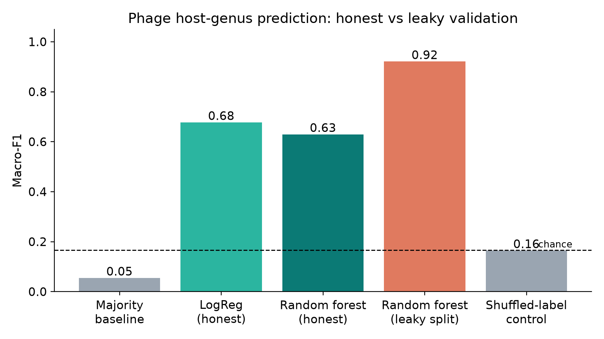
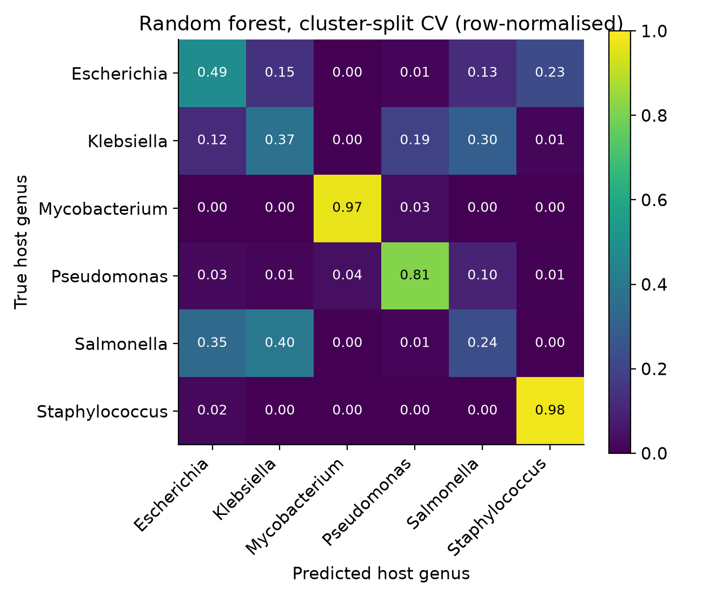

# GENEODE Phage Module: host-genus prediction (proof of concept)

Predicts which bacterial **genus** a bacteriophage infects, from its genome sequence alone,
and validates the result so that it cannot be inflated by near-identical genomes.

Part of the GENEODE bioinformatics platform (Samsung Innovation Campus AI Training Track).

## Why

Phage therapy against antibiotic-resistant bacteria needs fast host identification.
Most phages in public databases have no experimentally tested host range.

## Method

1. **Data:** 900 complete phage genomes from NCBI nuccore (20 to 400 kb), a random sample of
   150 for each of 6 host genera: *Escherichia, Klebsiella, Salmonella, Pseudomonas,
   Staphylococcus, Mycobacterium*. Label = the genus named in the NCBI record title
   (weak label, see Limitations).
2. **Features:** strand-symmetric 4-mer frequencies (256) plus GC content.
3. **Models:** majority-class baseline, logistic regression, random forest (500 trees).
4. **Validation (the important part):**
   - *Homology-aware split:* genomes are clustered by shared 10-mers (average-linkage on
     Jaccard distance, threshold 0.8, giving 188 clusters). Whole clusters go to train or test,
     never both (`StratifiedGroupKFold`, 5 folds).
   - *Leaky comparison:* the same model with an ordinary random split, to show how much
     leakage inflates the score.
   - *Negative control:* labels shuffled, the score must fall to chance.
   - *Sensitivity analysis:* k-mer size (3, 4, 5) and grouping threshold (0.6, 0.8, 0.9).
   - Metrics: macro-F1, balanced accuracy, per-genus report, confusion matrix.

The threshold of 0.8 and k = 4 were fixed before any results were seen. They are the headline
setting; everything else is reported as sensitivity analysis.

## Run

```
pip install -r requirements.txt
python run.py --email you@example.com
```

Options: `--genera`, `--per-genus`, `--k`, `--cluster-dist`, `--folds`, `--out-dir`,
`--skip-download`.

## Structure

```
geneode-phage/
├── run.py                 # entry point: download -> features -> validate -> figures
├── train_model.py         # train final model + confidence reliability table -> models/
├── predict.py             # helper: load a sequence -> checks, host call, next steps
├── phage_host/
│   ├── data.py            # NCBI download (multi-query fallback), FASTA loading, label check
│   ├── features.py        # k-mers, GC, homology clustering
│   ├── evaluate.py        # models, grouped vs leaky CV, shuffled control
│   ├── softchecks.py      # GC, ambiguity, ORF coding-likeness, MinHash novelty
│   ├── advisor.py         # builds the helper report and rule-based next steps
│   └── plots.py           # figures for slides
├── data/                  # FASTA files (created by run.py)
├── results/               # figures, results.json, clusters.csv
├── docs/presentation_outline.md
├── PLAN.md                # schedule and checklist
└── requirements.txt
```

## Results

900 genomes, 6 genera, 188 homology clusters, 5-fold cross-validation. Chance level = 1/6 = 0.167.

### Main result (k = 4, grouping threshold 0.8)

| Setting | Macro-F1 | Balanced accuracy |
|---|---|---|
| Majority baseline | 0.054 | 0.113 |
| Logistic regression (cluster split, honest) | 0.677 | 0.667 |
| Random forest (cluster split, honest) | 0.629 | 0.643 |
| Random forest (random split, leaky) | 0.921 | 0.920 |
| Random forest, shuffled labels (control) | 0.164 | 0.166 |



- The shuffled-label control sits at chance, so the pipeline does not leak.
- A naive random split overstates performance by about 0.29 macro-F1 (0.92 vs 0.63),
  because near-identical phages end up on both sides of the split.
- Logistic regression and random forest are comparable; their difference is within fold-to-fold
  variation (about ±0.07 to 0.11).

### Per-genus performance (random forest, honest split)

| Genus | Precision | Recall | F1 |
|---|---|---|---|
| Mycobacterium | 0.96 | 0.97 | 0.96 |
| Staphylococcus | 0.80 | 0.98 | 0.88 |
| Pseudomonas | 0.76 | 0.81 | 0.79 |
| Escherichia | 0.49 | 0.49 | 0.49 |
| Klebsiella | 0.40 | 0.37 | 0.39 |
| Salmonella | 0.31 | 0.24 | 0.27 |



Mycobacterium and Staphylococcus phages are compositionally distinctive. The three
Enterobacteriaceae hosts (*Escherichia, Klebsiella, Salmonella*) are closely related, their phages
have similar composition and some cross between hosts, and these are the genera the model confuses.
This is a biologically sensible error pattern, not random failure.

### Sensitivity analysis (macro-F1)

| k-mer size | Grouping threshold | LogReg (honest) | RF (honest) | RF (leaky) | Shuffled control | Clusters |
|---|---|---|---|---|---|---|
| 3 | 0.8 | 0.612 | 0.627 | 0.912 | 0.152 | 188 |
| **4** | **0.8 (default)** | **0.677** | **0.629** | **0.921** | **0.164** | **188** |
| 5 | 0.8 | 0.668 | 0.657 | 0.918 | 0.174 | 188 |
| 4 | 0.6 | 0.806 | 0.777 | 0.921 | 0.163 | 366 |
| 4 | 0.9 | 0.365 | 0.428 | 0.900 | 0.156 | 76 |


- **k-mer size has little effect** (honest F1 between 0.61 and 0.68 for k = 3 to 5, within
  fold-to-fold noise), so k = 4 is a reasonable choice.
- **The honest score depends on how strictly relatives are separated:** about 0.78 at threshold
  0.6, 0.63 at 0.8 and 0.43 at 0.9. The leaky score stays at 0.90 to 0.92 throughout because it
  removes nothing. The model recognises phages that resemble ones it has seen and generalises
  poorly to evolutionarily distant ones.
- The threshold 0.9 run is the least stable: only 76 clusters, and highly related
  mycobacteriophages merge into a few large groups, so entire groups are held out per fold
  (Mycobacterium recall falls to 0.10). Treat that number as indicative only.

## GENEODE helper: load a sequence, get checks, a host call and next steps

```
python train_model.py                    # once, after run.py has downloaded data/
python predict.py my_phage.fasta         # one or more records
python predict.py --accession NC_001604 --email you@example.com   # fetch from NCBI
```

For each sequence the helper reports:

1. **Soft checks:** length, GC content (compared with phages of the predicted host), ambiguous
   bases, and the fraction of the sequence inside long ORFs (phage genomes are gene-dense).
   Warnings are raised for fragments, ambiguous bases, unusual GC and non-gene-like sequence.
2. **Host-genus prediction** with the top 3 candidates and a **validated confidence**: for each
   confidence band, the report states how often predictions in that band were correct in honest
   cross-validation (`results/fig5_confidence_reliability.png`).
3. **Novelty check:** MinHash similarity to the nearest training genome, so the report says
   whether the input has a relative in the training set, or is an extrapolation (where validation
   showed much lower performance), or is a near-copy of a training genome (not an independent test).
4. **Suggested next steps:** annotation, lifestyle and safety screening, taxonomy, host-range
   confirmation, and, only if relevant, a cloning note. These are **rule-based workflow guidance,
   not model predictions**, and they adapt to the checks (for example, a low-confidence call
   recommends testing all candidate hosts).

The resolution is **host genus, not strain**. Strain-level identification needs reference-based
comparison (e.g. BLASTn, taxonomy tools) and is not claimed. The helper is decision support only.

## Limitations

- Labels come from NCBI record titles, not from experimentally confirmed host range.
- Genus level only; many phages infect several species or genera.
- Composition features only; no gene content or receptor-binding proteins yet.
- Six genera and 900 genomes; unseen genera cannot be predicted.
- No separate held-out test set yet; results are pooled predictions from grouped cross-validation.
  Hyperparameters were not tuned.
- Performance drops substantially on distantly related phages (see sensitivity analysis).

## Roadmap (GENEODE integration)

1. A held-out, cluster-separated test set and a small neural network baseline.
2. Protein-level features (tail fibers, receptor-binding proteins) and Evo 2 embeddings, aimed at
   the Enterobacteriaceae confusion and at distant phages.
3. Curated host-range labels, species-level prediction and confidence scores.
4. Expose as a GENEODE module: paste or upload a phage genome, get a predicted host with
   confidence, then cross-check against NCBI/UniProt records.
